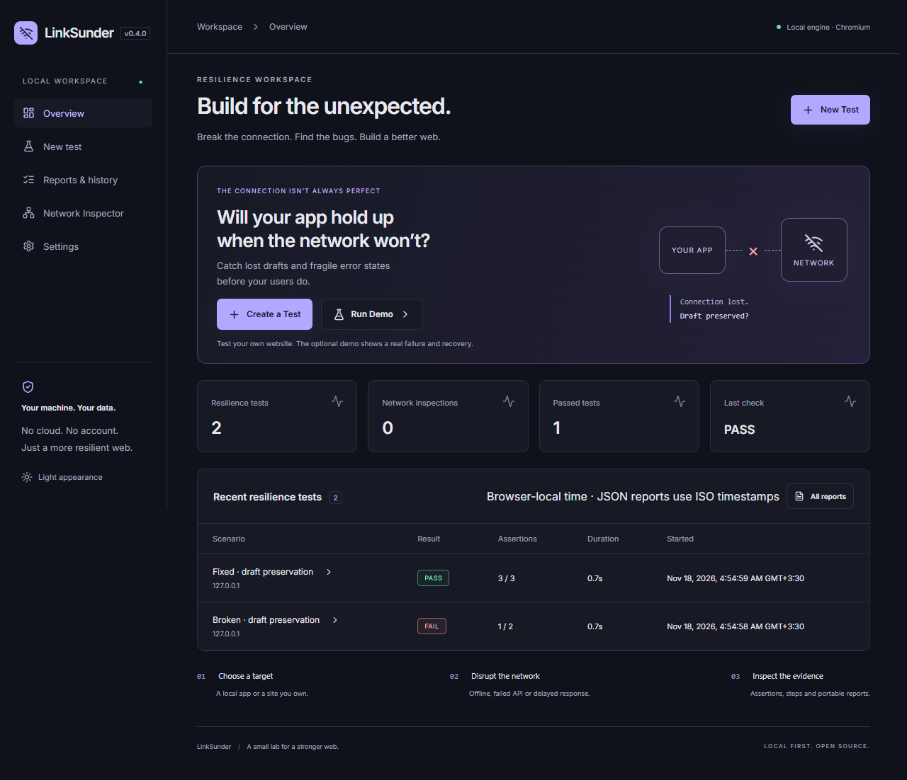

# LinkSunder

ابزاری متن‌باز و محلی برای آزمایش رفتار وب‌سایت هنگام قطع شبکه، خطای API و تأخیر درخواست‌ها.
بدون حساب کاربری، سرویس ابری یا API هوش مصنوعی کار می‌کند.

## دانلود نرم‌افزار

**[⬇ دانلود برای ویندوز — فایل نصب EXE](https://github.com/kavianpcx/linksunder/releases/download/v0.5.0/LinkSunder-0.5.0-Windows-x64.exe)** · **[⬇ دانلود برای لینوکس — فایل نصب DEB](https://github.com/kavianpcx/linksunder/releases/download/v0.5.0/LinkSunder-0.5.0-Linux-amd64.deb)**

**دانلود کنید ← نصب کنید ← LinkSunder را باز کنید.** هیچ دستور ترمینالی یا ابزار برنامه‌نویسی لازم نیست.
در ویندوز، روی فایل EXE دانلودشده دوبار کلیک کنید، نصب را تمام کنید و برنامه را از منوی Start یا میان‌بر دسکتاپ باز کنید.



## دانلود و استفاده بدون ترمینال

**[دریافت فایل آماده برای کامپیوتر](https://github.com/kavianpcx/linksunder/releases/latest)**

این محصول یک برنامه دسکتاپ با موتور واقعی تست است؛ نسخه محدود به دمو، آزمایشی یا
دارای امکانات پولی نیست. کاربر عادی لازم نیست Node، npm، Git یا Playwright نصب کند.

- **Windows:** [فایل نصب EXE را دانلود کنید](https://github.com/kavianpcx/linksunder/releases/download/v0.5.0/LinkSunder-0.5.0-Windows-x64.exe)؛ پس از نصب، LinkSunder را از منوی Start یا میان‌بر دسکتاپ اجرا کنید.
  برای نسخه قابل‌حمل، [فایل ZIP را دانلود کنید](https://github.com/kavianpcx/linksunder/releases/download/v0.5.0/LinkSunder-0.5.0-Windows-x64.zip)، کل پوشه را استخراج کنید و LinkSunder.exe را باز کنید.
- **Linux:** [فایل نصب DEB را دانلود کنید](https://github.com/kavianpcx/linksunder/releases/download/v0.5.0/LinkSunder-0.5.0-Linux-amd64.deb) و در Ubuntu/Debian با نصب‌کننده گرافیکی سیستم باز کنید؛ سپس برنامه را از فهرست Applications اجرا کنید.
  در محیط‌های سازگار، [فایل AppImage را دانلود کنید](https://github.com/kavianpcx/linksunder/releases/download/v0.5.0/LinkSunder-0.5.0-Linux-x86_64.AppImage) و مجوز اجرا را از Properties فعال کنید.
- موتور تست و Chromium داخل بسته هستند؛ با باز و بسته‌شدن برنامه خودکار شروع و متوقف می‌شوند.
- اطلاعات اجرا خارج از محل نصب، در پوشه داده برنامه ذخیره می‌شود. Download Report
  اجازه می‌دهد گزارش را در محل دلخواه ذخیره کنید.

فایل‌های نصب فعلاً گواهی تجاری امضای کد ندارند. سیاست امنیتی سازمان و سیستم‌عامل را
رعایت کنید و محافظت‌های سیستم را غیرفعال نکنید.

### اولین آزمون

1. در **New Test** آدرس سایتی را که مالک آن هستید وارد کنید و مجوز تست را تأیید کنید.
2. **Basic Website Health Check** پیش‌فرض را اجرا کنید و وضعیت HTTP، آماده‌شدن صفحه،
   درخواست‌های ناموفق، خطاهای JavaScript و زمان بارگذاری را در گزارش ببینید. این فقط
   بارگذاری اولیه صفحه را می‌سنجد و اثبات تاب‌آوری نیست.
3. برای آزمون تاب‌آوری، **Offline Recovery**، **API Failure** یا **Slow API Response**
   را انتخاب کنید و **Guided setup** را بزنید. نام دکمه/پیوند، مسیر API در صورت نیاز و
   متن مورد انتظار پیش از اختلال، حین آن و پس از بازیابی را وارد کنید.
4. مراحل ساخته‌شده را مرور کنید، مجوز تست همین هدف را تأیید کنید و **Run Resilience Test**
   را بزنید. تا وقتی درخواست واقعی، assertion و بررسی بازیابی تنظیم نشده باشد دکمه فعال نمی‌شود.
5. گزارش را دانلود کنید یا با **Save scenario** سناریو را برای دفعات بعد نگه دارید.
   فایل سناریو ممکن است ورودی‌های خصوصی شما را داشته باشد.

**Run Demo** مثال آموزشی اختیاری و جداگانه است؛ هدف پیش‌فرض New Test نیست و جای تست
وب‌سایت خودتان را نمی‌گیرد.

**Android و iOS:** طبق تصمیم نهایی، تمرکز محصول بر Windows و Linux است؛ APK یا
وب‌اپ میزبانی‌شده iOS عرضه نشده است. واکنش‌گرا بودن رابط به معنی وجود موتور مستقل موبایل نیست.

<details>
<summary>فقط برای توسعه‌دهندگان: اجرای سورس برنامه</summary>

## اجرای سورس

Node.js نسخه 22.12 به بالا (ترجیحاً 24 LTS) و npm لازم است.

```sh
npm install
npm run setup
npm run dev
```

آدرس `http://127.0.0.1:4317` را باز کنید و **Run Demo** را بزنید.
این دمو واقعاً فرم خراب و اصلاح‌شده را با Chromium آزمایش می‌کند:
نسخه خراب متن یادداشت را پاک می‌کند و FAIL می‌شود؛ نسخه اصلاح‌شده متن را حفظ می‌کند و PASS می‌شود.

برای نسخه ساخته‌شده، `npm run build` و سپس `npm run start` را اجرا کنید.
setup در ویندوز Chrome یا Edge موجود را بررسی می‌کند؛ در غیر این صورت Chromium را دانلود می‌کند.
در صورت محدودیت دانلود، مسیر مرورگر Chromium نصب‌شده را در `LINKSUNDER_BROWSER` تنظیم کنید.

</details>

## ساخت آزمون

برای شروع، **Basic Website Health Check** فقط یک بار صفحه را باز می‌کند و شواهد
قابل‌اندازه‌گیری آن را نشان می‌دهد؛ این بررسی جای آزمون تاب‌آوری را نمی‌گیرد. در بخش
**Guided setup** برای Offline Recovery، API Failure یا Slow API Response، نام قابل‌مشاهده
دکمه/پیوندی را وارد کنید که واقعاً درخواست شبکه می‌فرستد. در آزمون API، مسیر را مثل
`/api/messages` وارد کنید؛ می‌توانید آن را از گزارش Health Check کپی کنید. پیام مورد
انتظار در حالت عادی، هنگام اختلال و بعد از بازیابی را تعیین کنید. برای Slow API زمان
تأخیر بین ۱ تا ۱۵٬۰۰۰ میلی‌ثانیه قابل تنظیم است.

نیازی به نوشتن CSS selector در راهنمایی‌شده نیست. اگر به کنترل بیشتر نیاز دارید، مراحل
را دستی بسازید و از Check Element یا Check Field Value استفاده کنید. برای نتیجه معتبر،
آزمون باید رفتار مبنا، اختلال واقعاً فعال‌شده، assertion حین اختلال، درخواست بازیابی و
assertion بازیابی را ثبت کند.
بدون اختلال، آزمون تاب‌آوری تأیید نمی‌شود: اگر assertion وجود داشته باشد نتیجه **NOT TESTED**
است؛ اجرای صرفاً مشاهده‌ای **OBSERVED** می‌شود. Quick Scan بدون مراحل معنادار نیز **NOT TESTED**
است و شبکه را قطع نمی‌کند. برای PASS باید درخواست مبنا، تزریق واقعی اختلال، assertion حین اختلال،
درخواست بازیابی و assertion بازیابی ثبت شوند؛ اگر درخواست هدف رخ ندهد نتیجه **FAULT NOT TRIGGERED** است.

### API Test Builder

از منوی کناری، **API Test Builder** را برای ارسال درخواست کنترل‌شده باز کنید. GET پیش‌فرض است؛
پارامترهای query، header، بدنه اختیاری، مهلت، انتقال امن، وضعیت و زمان مورد انتظار، headerهای
پاسخ، assertionهای JSON و بخشی از JSON Schema پشتیبانی می‌شوند. تا دو retry فقط برای GET، HEAD و
OPTIONS ممکن است. برای POST، PUT، PATCH و DELETE تأیید صریح لازم است؛ این درخواست‌ها فقط یک بار
ارسال می‌شوند و retry یا شبیه‌سازی اختلالِ تکرارشونده ندارند. خطای 503 و تأخیر در مرز محلی
LinkSunder شبیه‌سازی می‌شوند و وضعیت سرور را تغییر نمی‌دهند. بدنه درخواست، اعتبارنامه و پاسخ خام
در گزارش ذخیره نمی‌شوند؛ پیش‌نمایش موقت JSON نیز فیلدهای حساس رایج را می‌پوشاند.

گزارش HTML مستقل از اینترنت و JSON از صفحه نتیجه قابل دریافت است.
تاریخچه در پوشه `data/` ذخیره می‌شود. با `LINKSUNDER_DATA` می‌توانید محل ذخیره را هنگام راه‌اندازی تغییر دهید.
تنظیم تم و مهلت پیش‌فرض از Settings در دسترس است؛ سناریوها به شکل فایل JSON وارد و خارج می‌شوند.

## Network Inspector

فقط سامانه‌ای را بررسی کنید که مالک آن هستید یا اجازه صریح دارید. پیش از شروع، برنامه
تأیید شما را می‌خواهد. در هر نوبت فقط یک میزبان بررسی می‌شود؛ حداکثر ۲۰ درگاه TCP یکتا
و حداکثر چهار اتصال هم‌زمان مجاز است و مهلت هر اتصال تا سه ثانیه محدود می‌شود.

- DNS: رکوردهای A، AAAA، CNAME، NS، MX، TXT و SOA، زمان و وضعیت جداگانه هر پرس‌وجو،
  خطاهای NXDOMAIN، timeout و resolver، آدرس‌های resolve‌شده توسط سیستم‌عامل به‌صورت جداگانه،
  و جست‌وجوی معکوس حداکثر سه IP. نبود رکورد با شکست resolver یکی نیست.
- TCP: **OPEN** یعنی اتصال پذیرفته شد؛ **CLOSED** یعنی اتصال رد شد؛ **UNKNOWN** یعنی
  میزبان پاسخ نداد یا مسیر شبکه در دسترس نبود؛ **ERROR** یعنی سیستم‌عامل نتوانست بررسی را کامل کند.
- HTTP و HTTPS: ابتدا `HEAD` و اگر سرور آن را با 405 یا 501 نپذیرد، `GET` محدود به یک بایت؛
  حداکثر پنج انتقال که فقط تا زمانی دنبال می‌شوند که نام میزبان ثابت بماند، وضعیت پاسخ،
  زمان پاسخ، اطلاعات منتخب، وجود هدرهای امنیتی و پرچم‌های امنیتی کوکی. انتقال به میزبان دیگر
  گزارش می‌شود اما دنبال نمی‌شود.
- TLS: خلاصه پایه گواهی روی درگاه منتخب ۴۴۳ یا ۸۴۴۳، شامل اعتبار، عدم تطابق نام میزبان،
  تاریخ اعتبار، انقضا، پروتکل و اثرانگشت در صورت دسترسی.
- یافته‌ها با شدت Info، Low، Medium و High توضیح می‌دهند چه مشاهده شده و چه کاری قابل بررسی است؛
  این برچسب‌ها حکم قطعی آسیب‌پذیری نیستند.

این ابزار بازه IP را اسکن نمی‌کند، از سرویس‌ها سوءاستفاده نمی‌کند، وارد حساب نمی‌شود و
اعتبارنامه نمی‌فرستد. بدنه پاسخ یا مقدار کوکی ذخیره نمی‌شود و بخش query و fragment پیش
از بررسی حذف می‌شود. بازبودن درگاه یا نبود یک هدر به‌تنهایی آسیب‌پذیری را ثابت نمی‌کند.
این ابزار جایگزین تست نفوذ کامل، ارزیابی رمزنگاری یا بازبینی امنیتی نیست.

### موقعیت‌یابی آفلاین IP (اختیاری)

در **Settings** فایل‌های محلی MaxMind City و/یا ASN با پسوند `.mmdb` را انتخاب کنید
تا کشور، منطقه، شهر، ASN و سازمانِ تقریبی IPهای عمومی به گزارش اضافه شود. فایل‌های
داده همراه برنامه نیستند؛ آن‌ها را از [MaxMind](https://www.maxmind.com/en/geolite-free-ip-geolocation-data)
دریافت و طبق شرایط مجوز، انتساب و به‌روزرسانی همان منبع نگهداری کنید. LinkSunder هیچ
IPای را به سرویس موقعیت‌یابی نمی‌فرستد و آدرس‌های خصوصی، رزروشده و مستنداتی را کنار
می‌گذارد. موقعیت تقریبی است و نمی‌تواند خانه یا محل دقیق یک نفر را مشخص کند. منطقه زمانی
در پایگاه داده نیز فقط تخمین مرتبط با بازه IP است.

## گزارش‌ها و تنظیمات

صفحه **Reports & history** گزارش تست‌های تاب‌آوری و Network Inspector را کنار هم نشان
می‌دهد. می‌توانید بر اساس نام یا هدف جست‌وجو کنید، نتیجه را باز کنید، دوباره به شکل JSON
یا HTML دانلود کنید و پس از تأیید یک یا چند گزارش یا کل تاریخچه تکمیل‌شده را حذف کنید.
جست‌وجو روی نمایه محلی سرور انجام می‌شود و هر صفحه فقط ۱۰، ۲۰ یا ۵۰ ردیف می‌گیرد.
پاک‌سازی بزرگ به‌صورت گروهی انجام می‌شود و پیشرفت دارد. بررسی در حال اجرا قابل حذف
نیست. گزارش‌ها تا زمان حذف دستی روی همین رایانه می‌مانند؛ پاک‌سازی خودکار فعال نیست.

در **Settings** می‌توانید با Browse یا واردکردن مسیر کامل، پوشه گزارش را عوض کنید.
برنامه دسترسی نوشتن را بررسی می‌کند، فایل‌های JSON و HTML را کپی و با SHA-256 کنترل
می‌کند و نسخه اصلی را نگه می‌دارد. مسیر انتخاب‌شده برای اجراهای بعدی ذخیره می‌شود.
فایل گزارش خراب بدون تغییر باقی می‌ماند و تعدادش نمایش داده می‌شود تا امکان بازیابی باشد.
تم، مهلت پیش‌فرض و انتخاب پیش‌فرض اسکرین‌شات محلی ذخیره می‌شوند. بازنشانی تنظیمات،
گزارش‌ها را جابه‌جا یا حذف نمی‌کند.
زمان نمایش گزارش را می‌توان روی ساعت محلی یا UTC گذاشت. اولین اجرا با پوشه گزارش قدیمی،
نمایه سبک `history.sqlite` را تدریجی می‌سازد؛ فایل‌های کامل گزارش را دوباره نمی‌نویسد
یا حذف نمی‌کند و پیشرفت و فایل‌های خراب را نشان می‌دهد.

### به‌روزرسانی برنامه

بخش **Software updates** در Settings فقط وقتی اینترنت را بررسی می‌کند که **Check for
Updates** را انتخاب کنید. دریافت و نصب خودکار نیست؛ نسخه، یادداشت انتشار، اندازه و
درصد، حجم، سرعت و پیشرفت واقعی دانلود نمایش داده می‌شود و امکان لغو و تلاش دوباره وجود دارد.
مکث/ادامه در نسخه فعلی پشتیبانی نمی‌شود؛ با لغو، قطع دانلود یا بسته‌شدن برنامه، فایل ناقص دور
ریخته می‌شود و تلاش بعدی از ابتدا شروع می‌شود. بسته با مقدار SHA-512 در فراداده‌ی انتشار رسمی GitHub بررسی می‌شود؛
نصب فقط پس از تأیید شما و پایان تست‌ها، جابه‌جایی گزارش‌ها و پاک‌سازی انجام می‌شود.

به‌روزرسانی درون‌برنامه‌ای برای نصب‌کننده **Windows NSIS** و بسته **Linux AppImage**
فعال است. فایل قابل‌حمل Windows ZIP و بسته Linux DEB را باید دستی از
[صفحه انتشار رسمی](https://github.com/kavianpcx/linksunder/releases) نصب کنید تا
مدیریت بسته سیستم‌عامل کنترل DEB را حفظ کند. بسته‌ها فعلاً امضای تجاری کد ندارند؛
checksum تغییر فایل را تشخیص می‌دهد اما هویت ناشر را ثابت نمی‌کند.

## امنیت و محدودیت‌ها

فقط سایت‌های خودتان یا سایت‌هایی را آزمایش کنید که مجوز دارید. اهداف خارجی تأیید صریح می‌خواهند.
داشبورد تنها روی loopback اجرا می‌شود. درخواست‌های خصوصی و metadata در تست خارجی مسدود می‌شوند.
این ابزار جایگزین sandbox امنیتی نیست و DNS rebinding را به‌طور کامل مسدود نمی‌کند.
گزارش‌ها درخواست، رمز یا کوکی را ثبت نمی‌کنند؛ اما محتوای صفحه می‌تواند خصوصی باشد.
اسکرین‌شات اختیاری است و فیلدها، `[data-sensitive]` و selectorهای انتخابی پوشانده می‌شوند.
تأخیر درخواست معادل شبیه‌سازی کامل اینترنت موبایل نیست.

## توسعه

`npm run lint`، `npm run typecheck`، `npm test` و `npm run test:e2e` را اجرا کنید.
تست‌های موتور واقعاً مرورگر را باز می‌کنند. [راهنمای انگلیسی](README.md) و [امنیت](SECURITY.md) جزئیات بیشتری دارند.
مجوز پروژه MIT است.
