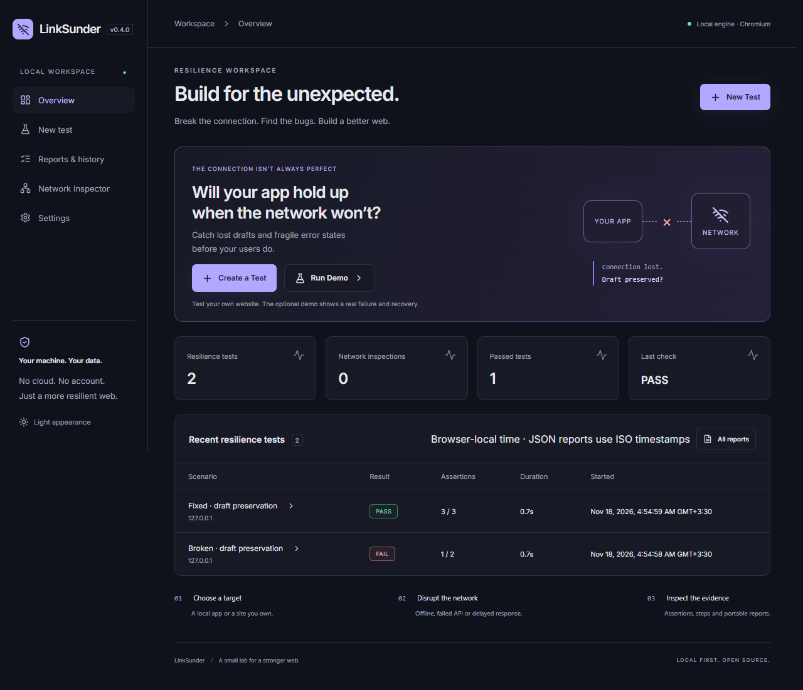
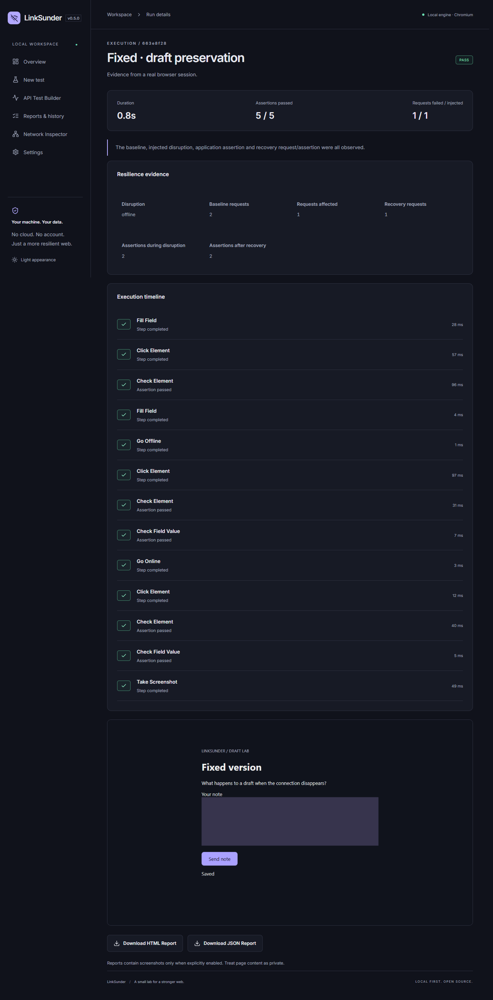
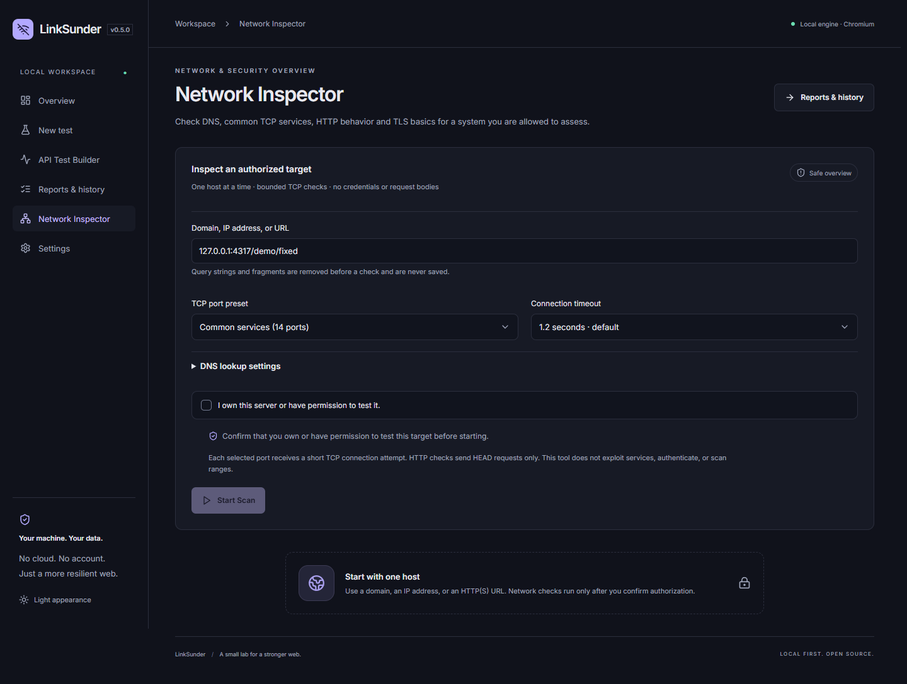
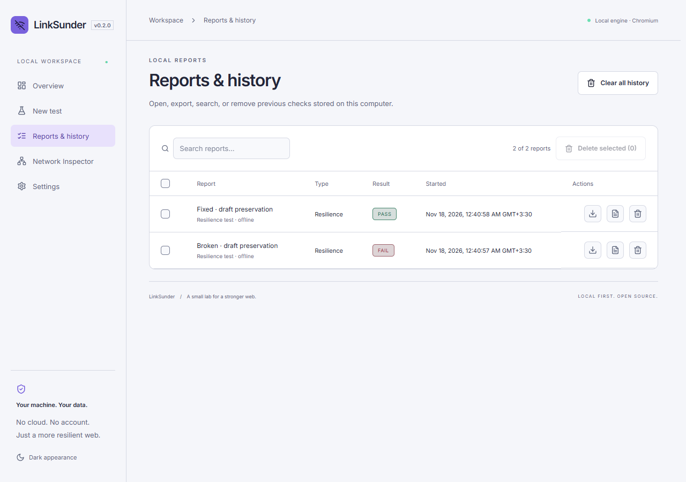
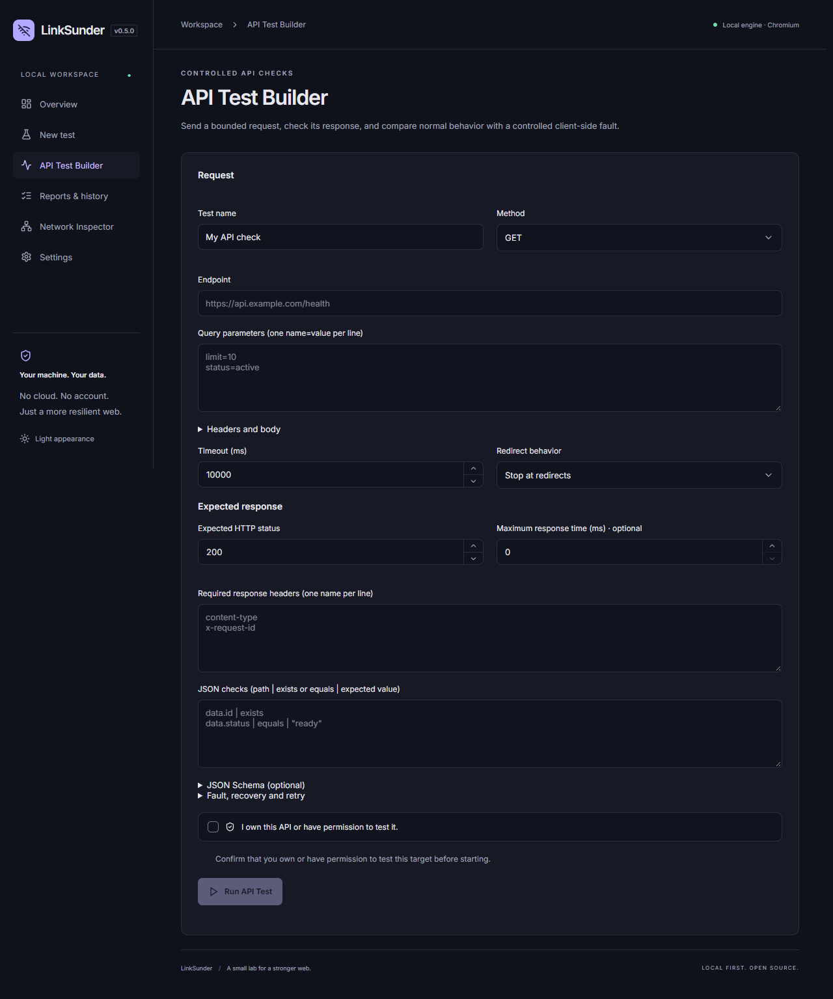

# ◇ LinkSunder

**Break the connection. Find the bugs. Build a better web.**

A local, open-source resilience lab for websites you own. Build a browser scenario,
disconnect the network, fail an API, or delay selected requests — then check whether
your UI preserves the state that matters. No account, cloud service, or AI API.

### Download the application

**[⬇ Download for Windows — EXE installer](https://github.com/kavianpcx/linksunder/releases/download/v0.5.1/LinkSunder-0.5.1-Windows-x64.exe)** · **[⬇ Download for Linux — DEB installer](https://github.com/kavianpcx/linksunder/releases/download/v0.5.1/LinkSunder-0.5.1-Linux-amd64.deb)**

**Download → Install → Open LinkSunder.** No terminal commands or developer tools required.
On Windows, open the downloaded EXE, finish installation, then open LinkSunder from Start or the desktop shortcut.

[راهنمای فارسی](README.fa.md) · [Scenarios](docs/scenarios.md) · [Security](SECURITY.md)



## Download and open — no terminal

**[Download LinkSunder for your computer](https://github.com/kavianpcx/linksunder/releases/latest)**

LinkSunder is a desktop application, with the real test engine included. Users do
not install Node.js, npm, Git or Playwright and do not type commands to start it.
There is no trial mode, demo-only edition, account or paid feature gate.

| Platform                             | File                                                                                                                         | What to do                                                                                                            |
| ------------------------------------ | ---------------------------------------------------------------------------------------------------------------------------- | --------------------------------------------------------------------------------------------------------------------- |
| Windows 11, x64                      | [Download EXE installer](https://github.com/kavianpcx/linksunder/releases/download/v0.5.1/LinkSunder-0.5.1-Windows-x64.exe)  | Open the installer, finish installation, then open LinkSunder from Start or the desktop shortcut.                     |
| Windows, x64 portable                | [Download ZIP](https://github.com/kavianpcx/linksunder/releases/download/v0.5.1/LinkSunder-0.5.1-Windows-x64.zip)            | Extract the entire folder and open `LinkSunder.exe`. Keep its resources beside it.                                    |
| Ubuntu / Debian desktop, x64         | [Download DEB installer](https://github.com/kavianpcx/linksunder/releases/download/v0.5.1/LinkSunder-0.5.1-Linux-amd64.deb)  | Open it in the system software installer, install, then launch LinkSunder from Applications.                          |
| Other compatible Linux desktops, x64 | [Download AppImage](https://github.com/kavianpcx/linksunder/releases/download/v0.5.1/LinkSunder-0.5.1-Linux-x86_64.AppImage) | Allow execution in file Properties, then double-click. System library/FUSE compatibility depends on the distribution. |

The desktop packages include the application runtime and test Chromium. They start
their engine automatically on loopback and stop it when the window closes. The
engine never needs to be started by the user. Reports are saved in application
data, outside the installation folder, and can be downloaded to any chosen folder.
The installer does not remove reports on uninstall. Installers currently have no
commercial code-signing certificate; follow your organization's publisher policy.
Do not disable operating-system protections to run a download.

**Android and iOS:** no APK, native mobile app or hosted iOS PWA is shipped. The
current product scope is Windows and Linux desktop, following the owner's clarified
requirements. A responsive UI does not mean a standalone mobile test engine exists.

### First test

1. Select **New Test**, enter the address of a website you own, and confirm that you have permission to test it.
2. Run the default **Basic Website Health Check** and review the response, ready state, request failures, JavaScript errors, and timing in its report. This checks the initial page load; it does not prove resilience.
3. For a resilience test, choose **Offline Recovery**, **API Failure**, or **Slow API Response**, then select **Guided setup**. Enter the visible button/link name, the API path where needed, and the expected messages before, during, and after the disruption.
4. Review the generated steps, confirm permission for the target, and select **Run Resilience Test**. The button remains disabled until the scenario includes a real trigger and recovery assertion.
5. Download the report or use **Save scenario** to reuse it. Saved scenarios may contain your test inputs.

The optional **Run Demo** button is a guided example inside the full application,
not a restriction on testing your own sites. There are no pre-filled fake results.

<details>
<summary>For developers only: build and run from source</summary>

## Build from source

Requires **Node.js 22.12+** (24 LTS recommended), npm, and Git.

```sh
git clone https://github.com/kavianpcx/linksunder.git
cd linksunder
npm install
npm run setup
npm run dev
```

Open **http://127.0.0.1:4317** and click **Run Demo**. Setup verifies an existing
Chrome/Edge installation on Windows, or downloads Playwright Chromium. On Linux,
install Playwright's documented OS prerequisites if missing (`npx playwright install --with-deps chromium`).
If the browser CDN is unavailable, set `LINKSUNDER_BROWSER` to an installed Chromium
executable before setup and startup. No administrator rights are required by this app.

For a production build: `npm run build`, then `npm run start`.

</details>

## Demo: the same failure, two different outcomes

The bundled note form has two implementations. A real Chromium session fills a
draft, goes offline, clicks Send, waits for the error state, and checks the field.

| Scenario | Expected evidence                                           |
| -------- | ----------------------------------------------------------- |
| Broken   | FAIL: the form clears the draft before the request succeeds |
| Fixed    | PASS: the draft survives the failed send and reconnection   |

The demo uses no external service. Its two results are saved to your real history.



## Features

- A responsive dashboard with dark/light themes, indexed server-side history, and one active run.
- Ordered no-code steps: open, click, fill, offline, online, fail/delay API, check
  element/value, and screenshot. Add, edit, remove, or reorder; import/export JSON.
- A one-click Basic Website Health Check with listed page-load evidence, plus Guided
  resilience setup for baseline, disruption, application response, and recovery.
- Chromium network emulation and controlled HTTP 503 responses.
- Resilience evidence for baseline requests, real fault triggers, assertions, and recovery. A run cannot pass just because a page opened; Quick Scan without a configured flow reports **NOT TESTED**.
- A focused API Test Builder for safe HTTP methods, headers, bodies, expected status/time/headers, JSON checks and schema checks, bounded retries, same-origin redirects, and local fault simulations. Data-changing methods require explicit confirmation and are never replayed automatically.
- Opt-in masked screenshots, cancellation, bounded timeouts, and isolated contexts.
- Self-contained offline HTML reports and JSON exports, persisted locally.
- A single-host Network Inspector for A/AAAA/CNAME/NS/MX/TXT/SOA DNS records with per-query status and timing, separate OS address resolution, bounded TCP checks, HEAD with a one-byte GET fallback when HEAD is rejected, TLS certificate basics, and practical findings.
- Searchable combined history for resilience and network reports, with confirmed
  single, bulk, or clear-all deletion, including progress for large cleanups.
- Server-side search and 10/20/50-row pagination backed by a local SQLite metadata
  index. Complete reports remain as separate JSON/HTML files; first-time legacy
  indexing runs incrementally and reports progress.
- Settings for report storage, appearance, local/UTC timestamps, default timeout,
  screenshot preference, optional local geolocation databases, and software updates.
- Optional offline IP geolocation with user-supplied MaxMind City and ASN databases;
  no IP address is sent to a geolocation service.
- User-triggered updates for Windows NSIS installers and Linux AppImage packages.
  Windows portable ZIP and Linux DEB users update manually through their usual installer.
- Results distinguish **PASS**, **FAIL**, **ERROR**, **CANCELLED**, **OBSERVED**, **NOT TESTED**, and **FAULT NOT TRIGGERED**. An observation or a missing fault trigger never counts as PASS.

## Network Inspector

Use this overview only for a system you own or are explicitly authorized to inspect.
The app requires an authorization confirmation before a check begins. It handles one
host at a time, allows up to 20 unique TCP ports, checks at most four ports in parallel,
and limits each connection timeout to three seconds.

- DNS: A, AAAA, CNAME, NS, MX, TXT and SOA queries through the configured resolver,
  each with a result classification, duration and bounded retry. Operating-system
  resolved addresses are shown separately from DNS record answers. No authoritative
  server trace is claimed; apex domains commonly lack CNAME records and subdomains may
  not publish NS records directly.
- TCP: **OPEN** means the connection was accepted; **CLOSED** means it was refused;
  **UNKNOWN** means the host did not respond or could not be reached; **ERROR** means
  the operating system could not complete the check.
- HTTP and HTTPS: `HEAD` first, with a one-byte range `GET` only if the server rejects
  `HEAD`; up to five redirects on the same hostname, status and selected response
  metadata, security-header presence, and cookie security flags. Redirects to another
  hostname are reported but are not followed.
- TLS: a basic certificate summary on selected port 443 or 8443, including trust,
  hostname mismatch, validity dates, expiry, protocol and fingerprint when available.
- Findings use Info, Low, Medium and High labels to explain observations and possible
  next steps. They are guidance, not a vulnerability verdict.

The inspector does not scan address ranges, exploit services, authenticate, or send
credentials. It does not read response bodies or save cookie values. Query strings and
fragments are removed before checks. TCP reachability, a missing header, or a TLS
summary alone does not establish that a system is vulnerable. This is not a full
penetration test, cryptographic assessment, or substitute for a security review.



### Optional offline IP geolocation

In **Settings**, select local MaxMind City and/or ASN `.mmdb` files to add approximate
country, region, city, ASN, and organization information for public IP addresses found
by an inspection. Databases are optional and are never bundled with LinkSunder. Get
GeoLite databases from [MaxMind](https://www.maxmind.com/en/geolite-free-ip-geolocation-data)
and follow its account, license, attribution, and update requirements. LinkSunder makes
no location-service requests and filters private, reserved, and documentation IPs.
Geolocation is approximate, may be missing or outdated, and cannot identify a household.
The time zone in a database is an estimate associated with the IP range, not the user's
or server's verified time zone.



## Reports and preferences

The **Reports & history** page combines resilience runs and network inspections. Search
by name or target on the local metadata index, choose 10, 20 or 50 rows per page, open a
saved result, download it again as JSON or standalone HTML, or delete one, selected
reports, or all completed history after confirmation. Large cleanup runs in resumable
batches and reports progress. Running checks cannot be deleted. Reports stay on this
computer until you remove them; automatic retention cleanup is not enabled.

In **Settings**, choose a report folder with Browse or enter an absolute path. LinkSunder
checks that the folder can be written, copies JSON and HTML reports, verifies each copy
with SHA-256, and keeps the original files. The selected folder is saved for future
launches. Corrupted report files are left in place and counted so they can be recovered;
they are not silently discarded. Appearance, default step timeout and screenshot
preference are stored locally. Reset defaults does not move or delete report files.
For report timestamps, choose **Local time**, **UTC**, or any time zone supported by
the system in Settings.

The first launch with an existing reports folder incrementally creates a local
`history.sqlite` metadata index; it does not rewrite or delete the source reports.
Indexing progress and damaged-file counts are available while it runs. The history page
then requests only the selected metadata page rather than downloading full reports.
Maintainers can run `npm run benchmark:history` to create isolated 100, 10,000, and
100,000-report fixtures, measure indexing/search/pagination/deletion, and measure actual
history-page navigation at 100,000 reports. The [recorded run](docs/benchmarks/history-v0.4.0.md)
states its hardware and limits; the benchmark never uses the user's report directory.

## Software updates

The **Software updates** section in Settings checks only after the user selects **Check
for Updates**. It shows release notes, package size, and live progress. Pause and
resume keep verified download progress; LinkSunder also saves progress when it closes
and checks release metadata again before resuming after restart. Cancel removes the
partial download. Outside Settings, a compact corner panel shows progress and offers a
Details view. Downloads and installation are never silent.

When a compatible base package is available, the updater downloads changed
package blocks. Otherwise, it downloads the package in resumable byte ranges. In both
cases, the completed package is checked against the SHA-512 value in official
[GitHub release metadata](https://github.com/kavianpcx/linksunder/releases), and
installation requires confirmation after active tests, migrations, and cleanup stop.
User reports and settings remain outside the installation directory.

In-app updates are supported for installed **Windows NSIS** packages and **Linux
AppImage** packages. The Windows portable ZIP and Linux DEB are updated manually from
the official [releases page](https://github.com/kavianpcx/linksunder/releases) so the
system package installer retains control of DEB updates. Packages currently do not have
commercial code signatures; checksums detect file changes but do not prove publisher
identity.

## How it works

The local API validates a scenario, opens an isolated headless Chromium context,
applies network rules, executes ordered steps, and evaluates explicit assertions.
Step status is polled by the dashboard; no synthetic progress percentages are used.
Runs are persisted in `data/` as JSON and standalone HTML with embedded PNGs.

API fault rules apply to an exact normalized pathname after a browser action. A resilience
PASS requires a successful baseline request, a real matching faulted request, an assertion
during disruption, a recovery request, and a recovery assertion. If the request never
matches, the report says **FAULT NOT TRIGGERED**. Delays affect selected HTTP requests,
not mobile bandwidth, packet loss, or an entire carrier network. A Quick Scan without
configured actions reports **NOT TESTED** and does not alter connectivity.

### API Test Builder

Open **API Test Builder** from the sidebar to send a bounded request. GET is the default.
The builder records baseline, simulated-fault and recovery measurements for safe methods.
It supports query parameters, headers, optional bodies, timeouts, redirect choices,
expected status/time/headers, JSON property checks, a practical JSON Schema subset, and
up to two explicitly configured retries. POST, PUT, PATCH and DELETE require confirmation;
the builder sends them once and disables retries and repeat-request fault simulations.
HTTP 503 simulation changes the response only at LinkSunder's local client boundary; it
does not make the API server return 503. Request headers, request bodies, cookies and raw
response bodies are not saved. Temporary JSON previews mask common credential and
personal-data fields; plain-text body previews are hidden. The API client does not expose
the negotiated HTTP version, so the report marks it unavailable.



## Architecture

```text
client/   React + TypeScript dashboard, served through Vite in development
server/   Fastify API, Playwright runner, policy and report generation
shared/   Zod scenario schema and shared result types
demo/     Deliberately broken and corrected local form
tests/    Unit, browser integration and dashboard E2E tests
docs/     Scenarios, screenshots, release notes and launch drafts
desktop/  Electron window, isolated preload bridge, and packaging configuration
```

The server binds only to `127.0.0.1`. The dashboard, API and demo share one port.
`PORT` changes it. `LINKSUNDER_DATA` selects the initial report directory; it is an
operator environment setting, never a path accepted from a browser request. In the
desktop app, reports and settings live in the operating system's LinkSunder app-data
folder unless the user selects another report directory.

## Safety and limits

Use only on sites you own or have authorization to test. External targets require
explicit consent. HTTP(S) targets only; embedded URL credentials are rejected.
Other loopback origins, private and metadata IPs are blocked during external tests.
Requests and redirects are checked; service workers and WebSockets are disabled.
No saved browser profile, telemetry, request-body/header/cookie logging, or cloud upload.
Form fields and `[data-sensitive]` elements are masked in opt-in screenshots;
add extra selectors for other sensitive content. Scenario JSON may contain your
test inputs — protect it. Treat all reports and screenshots as private.

This is a trusted, single-user developer tool, **not a sandbox for hostile sites**.
DNS checks are not connection-level IP pinning and cannot eliminate DNS rebinding.
Browser background traffic, WebRTC and arbitrary third-party page behavior are not
fully sandboxed by HTTP routing. See [SECURITY.md](SECURITY.md) before external tests.
Scenarios can be saved on this computer or imported/exported as files; there is no browser recorder,
authentication flow, or automatic repair advice beyond
rule-based suggestions. English UI; Persian documentation included.

## Compared with existing tools

| Tool             | Best fit                                                                        |
| ---------------- | ------------------------------------------------------------------------------- |
| Browser DevTools | Manual network inspection and throttling in an interactive session              |
| Playwright       | Code-first browser automation with arbitrary assertions                         |
| LinkSunder       | A small local UI for repeatable network-failure scenarios and portable evidence |

LinkSunder uses Playwright; it complements these tools and does not replace their flexibility.
References: [Chrome network tools](https://developer.chrome.com/docs/devtools/network/),
[Playwright network routing](https://playwright.dev/docs/network).

## Development and contributing

```sh
npm run lint
npm run typecheck
npm test
npm run test:e2e
npm run build
```

`npm test` includes real browser integration tests; run setup first. E2E tests use
fresh subdirectories in `.e2e-data/` and write real screenshots to `docs/screenshots/`.
Stop the development server before E2E tests (they own port 4317). CI covers checks on
Linux and Windows. Anyone can fork the project and propose changes without upstream
write access; see [CONTRIBUTING.md](CONTRIBUTING.md) for the step-by-step guide and
the [roadmap](docs/roadmap.md) for planned work.

## License

[MIT](LICENSE). Contributions welcome.

## Original project

LinkSunder is an open-source project originally maintained by
[kavianpcx](https://github.com/kavianpcx). If you are using a fork, please refer
to the [official upstream repository](https://github.com/kavianpcx/linksunder)
for the original project and updates. Linking back to the upstream project is
appreciated.
